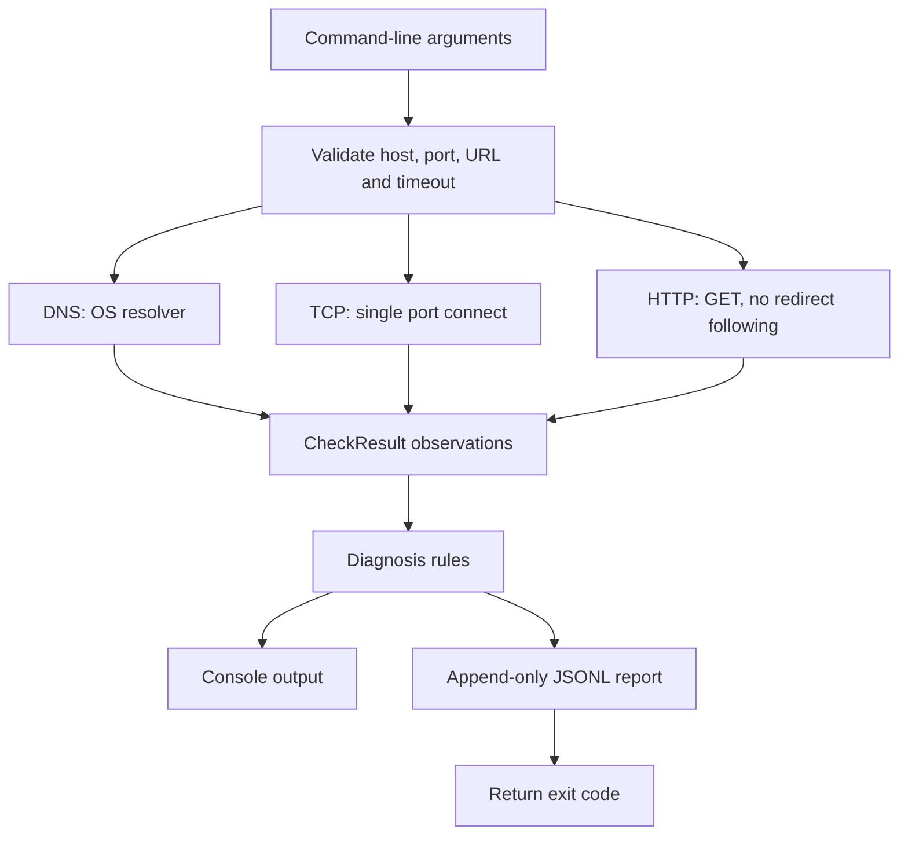

# Network Diagnostics Toolkit — Architecture

## Purpose

The tool isolates common connectivity observations into **DNS**, **TCP**, and **HTTP** checks, interprets their independent outcomes, and writes timestamped JSONL records. It is a single-target diagnostics utility, not a scanner or production monitoring agent.

## Data flow

## Design decisions

| Decision | Engineering reason | Limitation |
|---|---|---|
| Independent checks rather than early exit | Can expose conflicting/transient evidence | Results are not a single synchronized snapshot |
| One TCP port only | Keeps troubleshooting focused and authorized | No port discovery |
| HTTP 2xx means success | Clearly distinguishes reachability from HTTP status | Does not verify application business logic |
| Do not follow HTTP redirects | Exposes 3xx responses explicitly | Does not test redirect destination |
| Validate URL/host/port and disallow URL credentials/query | Reduces accidental target mismatch and sensitive query logging | Paths, hosts and errors can still be sensitive |
| Append JSONL | Easy to parse, append and inspect without dependencies | No concurrent-writer safety or log rotation |
| Rule-based diagnosis | Deterministic and testable suggestions | Not guaranteed root cause |
| OS-backed DNS resolution | Reflects local resolver behavior | DNS can exceed selected TCP/HTTP timeout |

## Exit codes

- `0` — all selected checks passed and the report saved
- `1` — one or more checks failed, report saved
- `2` — invalid CLI input, no checks performed
- `3` — report cannot be written

Use `python -m unittest discover -s tests -v` to validate the source. All integration tests bind to `127.0.0.1` and use an ephemeral local port; no public service is required.
